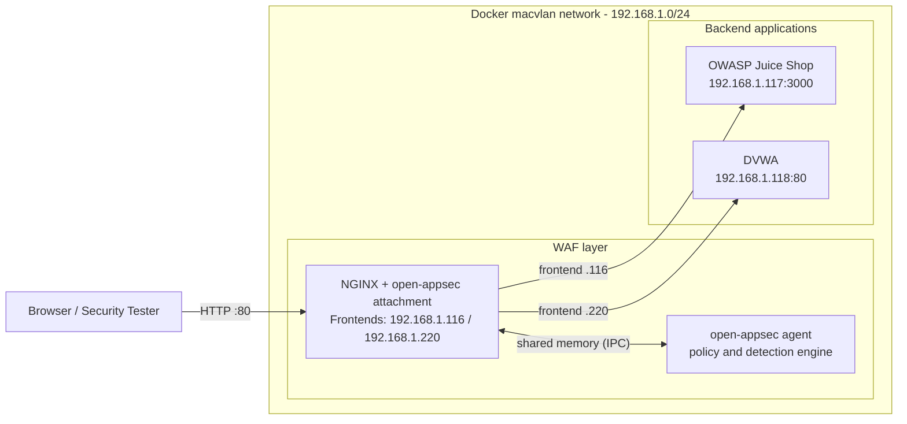

# open-appsec WAF Security Lab


A hands-on Web Application Firewall (WAF) lab that places **open-appsec**
and **NGINX** in front of two intentionally vulnerable applications,
**OWASP Juice Shop** and **DVWA**, to study reverse-proxy architecture,
HTTP traffic inspection, custom Snort signatures, and attack detection
and prevention.

> **Lab use only.** Juice Shop and DVWA are deliberately vulnerable.
> Run this environment on an isolated network and test only systems you
> own or are explicitly authorized to test.

---

## Architecture



NGINX selects the backend from the **local address that received the
request** (`map $server_addr $backend`). The open-appsec attachment
inspects each request and the agent applies the active security policy
before the request is forwarded.

| Frontend (client-facing) | Backend application | Backend address |
|---|---|---|
| 192.168.1.116 | OWASP Juice Shop | 192.168.1.117:3000 |
| 192.168.1.220 | DVWA | 192.168.1.118:80 |

Full details: [Network Architecture](architecture/architecture.md)

---

## Components

| Component | Image / Tool | Role |
|---|---|---|
| open-appsec agent | `ghcr.io/openappsec/agent` | Security engine and policy management |
| open-appsec NGINX attachment | `ghcr.io/openappsec/nginx-attachment` | NGINX with inspection integration |
| OWASP Juice Shop | `bkimminich/juice-shop` | Vulnerable modern web application |
| DVWA | `vulnerables/web-dvwa` | Classic vulnerable PHP application |

---

## Quick Start

```bash
git clone https://github.com/Pamidipallikiran/open-appsec-waf-security-lab.git
cd open-appsec-waf-security-lab

cp .env.example .env
nano .env                       # add your own agent token and e-mail

docker compose --env-file .env config --quiet   # validate
docker compose up -d
docker compose ps
```

Prerequisites (macvlan network, backend containers, host requirements)
are in the [Docker Deployment guide](documentation/docker-deployment.md).

---

## Verification Status

| Path | Status | Evidence |
|---|---|---|
| Juice Shop frontend (192.168.1.116) | Verified | Custom Snort signature `1000001` detects and blocks a matching SQL injection request |
| DVWA frontend (192.168.1.220) | Verified | Diagnostic signatures `1000030` and `1000031` produced **Web Snort** events with action *Prevent* |
| Combined SVG/XSS Referer signature `1000032` | Under investigation | No Web Snort event yet; see [Custom Snort Rules](detection/custom-snort-rules.md) |

> An HTTP response alone does not prove detection. Always confirm in the
> open-appsec event log (Practice SubType, Protection Name, Security
> Action). Details and a controlled test procedure are in the
> [detection guide](detection/custom-snort-rules.md).

---

## Documentation

| Document | Contents |
|---|---|
| [Network Architecture](architecture/architecture.md) | Topology, traffic flow, macvlan settings |
| [NGINX Configuration](documentation/nginx-configuration.md) | Backend selection and proxy directives |
| [Docker Deployment](documentation/docker-deployment.md) | Containers, networks, volumes, setup steps |
| [Custom Snort Rules](detection/custom-snort-rules.md) | Signatures, tests, and verification method |

---

## Repository Structure

```text
open-appsec-waf-security-lab/
├── architecture/
│   └── architecture.md
├── configurations/
│   └── nginx/
│       └── default.conf
├── detection/
│   ├── custom-snort-rules.md
│   └── rules/
│       └── lab-rules.rules
├── documentation/
│   ├── docker-deployment.md
│   └── nginx-configuration.md
├── .env.example
├── .gitignore
├── compose.yaml
└── README.md
```

---

## Security Notes

- Secrets live only in a local `.env` (git-ignored). Only `.env.example`
  is committed. Never publish agent tokens.
- Agent state under `appsec-config/`, `appsec-data/` and `appsec-logs/`
  is git-ignored because it can contain registration material.
- The agent and NGINX containers use `ipc: host` and a shared
  `/dev/shm/check-point` mount, as required by the integration. Treat
  the host as trusted lab infrastructure.
- Restrict direct access to the backend IPs (192.168.1.117 and
  192.168.1.118) so traffic cannot bypass the WAF.

---

## Learning Objectives

- Deploy open-appsec with NGINX in containers
- Understand reverse-proxy routing and backend selection
- Inspect HTTP traffic through a WAF integration
- Write, import and verify custom Snort signatures
- Distinguish built-in detections from custom signature matches
- Understand why backend access must be restricted

---

## Disclaimer

Educational and authorized security testing only. The vulnerable
applications must never be exposed to untrusted networks.

## Author

**Kiran Pamidipalli** - Cybersecurity / SOC Analyst
