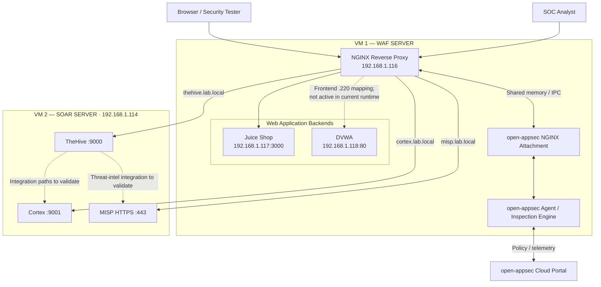

# open-appsec WAF Security Lab


A hands-on Web Application Firewall and SOC integration lab. The WAF
layer uses **open-appsec + NGINX** to protect and reverse-proxy
intentionally vulnerable applications. The extended deployment also
publishes **TheHive, Cortex, and MISP** from a separate SOAR VM through
the same NGINX frontend.

> **Lab use only.** Juice Shop and DVWA are deliberately vulnerable.
> Run this environment on an isolated network and test only systems you
> own or are explicitly authorized to test.

---

## Overall architecture

The extended deployment has two virtual machines:

- **WAF VM:** NGINX, the open-appsec NGINX attachment, and the
  open-appsec agent. It reverse-proxies web applications and the SOAR
  web interfaces.
- **SOAR VM:** TheHive, Cortex, and MISP. These services remain on a
  separate host and are reached through NGINX virtual hosts.



See [Overall WAF and SOAR Architecture](architecture/architecture.md)
for the complete topology, network inventory, traffic flow, and
validation boundaries.

## Network and service inventory

| Component | Address | Access |
|---|---|---|
| WAF NGINX frontend | `192.168.1.116` | HTTP / HTTPS virtual hosts |
| Juice Shop backend | `192.168.1.117:3000` | Through WAF |
| DVWA backend | `192.168.1.118:80` | Through WAF; frontend .220 currently pending |
| SOAR VM | `192.168.1.114` | Separate VM |
| TheHive | `192.168.1.114:9000` | `thehive.lab.local` |
| Cortex | `192.168.1.114:9001` | `cortex.lab.local` |
| MISP | `192.168.1.114:443` | `misp.lab.local` |

The current SOAR VM address is `192.168.1.114`; do not use the
previous address `192.168.1.112`.

## Components

| Component | Role |
|---|---|
| open-appsec agent | WAF inspection engine and policy management |
| open-appsec NGINX attachment | Integrates NGINX request processing with open-appsec |
| NGINX | Client-facing reverse proxy and virtual-host routing |
| OWASP Juice Shop | Intentionally vulnerable web application |
| DVWA | Intentionally vulnerable web application |
| TheHive | Security incident and case management |
| Cortex | Analyzer and responder platform |
| MISP | Threat-intelligence platform |

The WAF Compose template deploys only the open-appsec agent and NGINX
attachment. The vulnerable applications and SOAR stack are separate
services/hosts in the observed lab; they are not added to that Compose
project.

## Quick Start — WAF core

```bash
git clone https://github.com/Pamidipallikiran/open-appsec-waf-security-lab.git
cd open-appsec-waf-security-lab

cp .env.example .env
nano .env                       # add your own agent token and e-mail

docker compose --env-file .env config --quiet   # validate
docker compose up -d
docker compose ps
```

Prerequisites (macvlan network, backend containers, host requirements)
are in the [Docker Deployment guide](documentation/docker-deployment.md).

The SOAR reverse-proxy topology and validation procedure are documented
separately in [SOAR Integration](documentation/soar-integration.md).
Do not run the WAF Compose template on the SOAR VM.

## Verification status and evidence

| Area | Status | Evidence / limitation |
|---|---|---|
| Juice Shop reverse proxy | Verified | Baseline application response through WAF frontend |
| TheHive reverse proxy | Verified | Application HTML returned through WAF frontend |
| Cortex reverse proxy | Verified | Expected redirect / application response through WAF frontend |
| MISP reverse proxy | Verified | Expected login redirect through HTTPS WAF frontend |
| open-appsec NGINX module / attachment | Verified | Module loaded and attachment registration observed |
| WAF detection / prevention on the current expanded runtime | Needs event-level validation | Confirm the matching portal event and action; an HTTP response alone is insufficient |
| DVWA frontend .220 | Pending in current runtime | Backend map exists, but .220 is not attached to the active NGINX container |
| Automatic WAF-event-to-TheHive case creation | Not verified | Treat as a future integration until a controlled end-to-end test succeeds |
| TheHive-to-Cortex / MISP integrations | Validate separately | Reverse-proxy access does not prove application-level integration |

Historical custom Snort signature tests are documented in
[Custom Snort Rules](detection/custom-snort-rules.md). Re-run the
controlled tests against the current runtime and confirm the event's
Practice SubType, Protection Name, and Security Action before reporting
a detection or prevention result.

## Documentation

| Document | Contents |
|---|---|
| [Overall WAF and SOAR Architecture](architecture/architecture.md) | Two-VM topology, IP inventory, request flow, SOAR workflow |
| [SOAR Reverse-Proxy Integration](documentation/soar-integration.md) | TheHive, Cortex, and MISP routing and validation |
| [NGINX Configuration](documentation/nginx-configuration.md) | Backend selection and proxy directives |
| [Docker Deployment](documentation/docker-deployment.md) | WAF containers, networks, volumes, setup |
| [Custom Snort Rules](detection/custom-snort-rules.md) | Signatures, controlled tests, and event verification |

## Repository structure

```text
open-appsec-waf-security-lab/
├── architecture/
│   └── architecture.md
├── configurations/
│   └── nginx/
│       └── default.conf
├── detection/
│   ├── custom-snort-rules.md
│   └── rules/
│       └── lab-rules.rules
├── documentation/
│   ├── docker-deployment.md
│   ├── nginx-configuration.md
│   └── soar-integration.md
├── .env.example
├── .gitignore
├── compose.yaml
└── README.md
```

## Security notes

- Secrets live only in a local `.env` (git-ignored). Only
  `.env.example` is committed. Never publish agent tokens, API keys,
  passwords, or private keys.
- Agent state and runtime data are git-ignored because they can contain
  registration material.
- The agent and NGINX attachment use host IPC and a shared-memory mount
  as required by this integration. Treat the host as trusted lab
  infrastructure.
- Restrict direct access to backend applications and SOAR service ports
  so traffic cannot bypass the intended reverse-proxy path.
- The current MISP upstream TLS verification bypass is lab-only. Use a
  trusted certificate and enable verification for production.
- Keep the deliberately vulnerable applications isolated from untrusted
  networks.

## Learning objectives

- Deploy open-appsec with NGINX in containers.
- Understand reverse-proxy routing and backend selection.
- Inspect HTTP traffic through a WAF integration.
- Write, import, and verify custom Snort signatures.
- Distinguish detection from prevention using authoritative events.
- Publish multiple applications through NGINX virtual hosts.
- Understand how TheHive, Cortex, and MISP support SOC investigation.
- Separate reverse-proxy connectivity from end-to-end SOAR automation.

## Disclaimer

Educational and authorized security testing only. The vulnerable
applications must never be exposed to untrusted networks.

## Author

**Kiran Pamidipalli** — Cybersecurity / SOC Analyst
