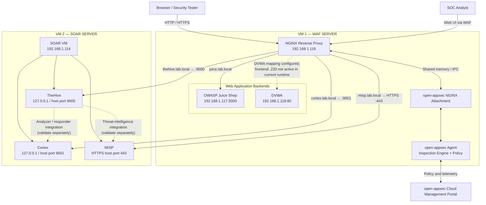
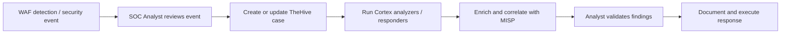

# Overall WAF and SOAR Lab Architecture

## 1. Purpose

This document describes the extended lab: an open-appsec-protected NGINX
reverse-proxy VM in front of vulnerable web applications and a separate
SOAR VM hosting TheHive, Cortex, and MISP.

The deployment is split across two virtual machines. The open-appsec
agent and NGINX attachment run on the WAF VM. TheHive, Cortex, and MISP
remain on the SOAR VM; they are published through NGINX virtual hosts
on the WAF VM.

> **Scope and accuracy:** This is the observed lab topology and its
> documented routing. A working reverse-proxy response confirms
> connectivity, not a security verdict. Do not describe a request as
> blocked unless the corresponding open-appsec event or Prevent verdict
> has been verified.

## 2. High-level architecture

The open-appsec cloud portal manages policy and receives telemetry; it is
not the inline destination for application traffic. NGINX is the
client-facing reverse proxy. The open-appsec NGINX attachment connects
NGINX request processing to the local agent through shared-memory IPC.

## 3. VM and network inventory

### VM 1 — WAF server

| Component | Address | Role |
|---|---|---|
| NGINX / open-appsec frontend | `192.168.1.116` | Client-facing reverse proxy and WAF integration |
| Juice Shop | `192.168.1.117:3000` | Intentionally vulnerable web application |
| DVWA | `192.168.1.118:80` | Intentionally vulnerable web application |
| Additional DVWA frontend mapping | `192.168.1.220` | Configured in the backend map; not attached to the current active NGINX container |

The WAF VM's active NGINX configuration also contains virtual hosts
for TheHive, Cortex, and MISP. The exact live configuration is maintained
on the VM under `/home/kiranwaf/open-appsec-lab/nginx-config/`.
The repository's `configurations/nginx/default.conf` remains the
reproducible core Juice Shop / DVWA example.

### VM 2 — SOAR server

| Service | SOAR backend | Published hostname through WAF |
|---|---|---|
| TheHive | `192.168.1.114:9000` | `thehive.lab.local` |
| Cortex | `192.168.1.114:9001` | `cortex.lab.local` |
| MISP | `192.168.1.114:443` (HTTPS) | `misp.lab.local` |

The SOAR VM's current address is `192.168.1.114`. Do not use the
previous address `192.168.1.112` in new configuration.

### Client name resolution

On each client that needs to use the lab hostnames, create the
appropriate local DNS records or hosts-file entries pointing to the
WAF frontend address:

| Hostname | WAF address |
|---|---|
| `juice.lab.local` | `192.168.1.116` |
| `thehive.lab.local` | `192.168.1.116` |
| `cortex.lab.local` | `192.168.1.116` |
| `misp.lab.local` | `192.168.1.116` |
| `dvwa.lab.local` | `192.168.1.220` — only after that frontend is activated |

Use the scheme and port configured for each virtual host. TheHive and
Cortex were tested through HTTP; MISP was tested through HTTPS.

## 4. Request and inspection flow

1. A browser resolves the lab hostname to the WAF frontend.
2. The request reaches NGINX on the WAF VM.
3. The open-appsec NGINX attachment makes the request available to the
   local inspection engine through the configured IPC integration.
4. open-appsec evaluates the request against the policy and protection
   settings assigned to the asset.
5. In **Prevent** mode, a request that matches a protection configured
   to prevent can be blocked. In **Detect** mode, the event can be
   reported without blocking the request.
6. Requests allowed by the active policy are routed by the matching
   NGINX virtual host to the selected backend.
7. The backend response returns through NGINX to the client.

The open-appsec cloud portal is used to manage policy and review events.
A successful HTTP response from an upstream service is not, by itself,
proof that the WAF inspected the request or that a malicious request
was detected.

## 5. Reverse-proxy routing

| Virtual host | Upstream destination | Protocol to upstream |
|---|---|---|
| `juice.lab.local` | `192.168.1.117:3000` | HTTP |
| `thehive.lab.local` | `192.168.1.114:9000` | HTTP |
| `cortex.lab.local` | `192.168.1.114:9001` | HTTP |
| `misp.lab.local` | `192.168.1.114:443` | HTTPS |
| DVWA frontend `192.168.1.220` | `192.168.1.118:80` | HTTP |

TheHive, Cortex, and MISP reverse-proxy paths returned expected
application responses during connectivity testing. MISP uses an
upstream TLS certificate that is not trusted by the proxy in this lab;
the current proxy configuration disables upstream certificate
verification. This is a lab-only compromise. Use a trusted certificate
and enable verification for production deployments.

## 6. SOAR investigation workflow

The intended analyst workflow is:

This diagram describes the operational workflow, not an assertion that
WAF events are automatically forwarded to TheHive. Automatic
open-appsec-to-TheHive case creation and TheHive/Cortex/MISP
integrations must each be configured and tested separately.

## 7. Deployment boundaries

- The repository's `compose.yaml` deploys the core open-appsec agent
  and NGINX attachment services only.
- Juice Shop and DVWA are separate backend containers in the observed
  lab; they are not created by the core Compose template.
- TheHive, Cortex, and MISP run on the separate SOAR VM and are not
  added to the WAF VM's Compose project.
- Do not merge the two VMs' Compose stacks or reuse their IP addresses.
- Restrict direct access to backend ports so clients cannot bypass the
  WAF reverse proxy.
- Keep agent tokens, API keys, passwords, and TLS private keys out of
  Git. Use local environment files or a secrets manager.

## 8. Validation checklist

| Validation | Evidence required |
|---|---|
| NGINX reverse proxy | Expected application response from each hostname |
| open-appsec attachment | Module loaded and attachment registered |
| WAF detection | Matching event in open-appsec portal or authoritative agent event log |
| WAF prevention | Matching event with Prevent action and request blocked before reaching backend |
| TheHive / Cortex / MISP UI | Each hostname returns the expected application response |
| SOAR integrations | Successful test observable or case enrichment in the receiving application |
| Automatic WAF-to-TheHive workflow | A controlled WAF event creates or updates the intended TheHive case |

For deployment-specific configuration and verification commands, see
[SOAR reverse-proxy integration](../documentation/soar-integration.md),
[NGINX configuration](../documentation/nginx-configuration.md), and
[Custom Snort Rules](../detection/custom-snort-rules.md).
