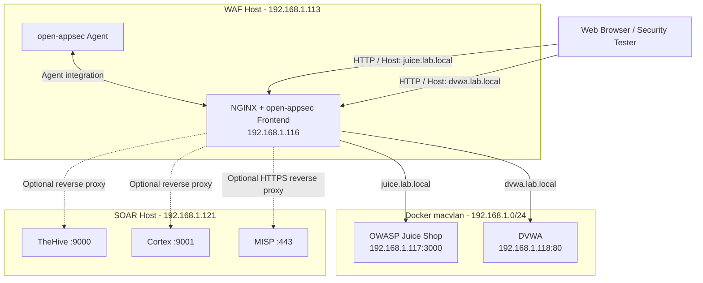

# open-appsec WAF Lab Architecture

## 1. Overview

This lab integrates open-appsec with NGINX to inspect HTTP requests before forwarding permitted traffic to vulnerable web applications.

The deployment uses one NGINX frontend with hostname-based routing to two backends:

- OWASP Juice Shop
- Damn Vulnerable Web Application (DVWA)

Optional reverse-proxy configurations provide access to TheHive, Cortex and MISP hosted on the separate SOAR machine.

## 2. Network Architecture

The open-appsec agent and NGINX frontend are separate containers. The frontend is attached to the macvlan network, while the agent uses the deployment shared integration configuration.

## 3. Network Details

| Component | Address | Purpose |
|---|---|---|
| WAF host | 192.168.1.113 | Ubuntu host running the WAF deployment |
| NGINX frontend | 192.168.1.116 | Client-facing WAF entry point |
| Juice Shop | 192.168.1.117:3000 | Vulnerable application backend |
| DVWA | 192.168.1.118:80 | Vulnerable application backend |
| SOAR host | 192.168.1.121 | TheHive, Cortex and MISP |

### Hostname routing

| Hostname | Frontend | Backend |
|---|---|---|
| juice.lab.local | 192.168.1.116:80 | 192.168.1.117:3000 |
| dvwa.lab.local | 192.168.1.116:80 | 192.168.1.118:80 |
| thehive.lab.local | 192.168.1.116:80 | 192.168.1.121:9000 |
| cortex.lab.local | 192.168.1.116:80 | 192.168.1.121:9001 |
| misp.lab.local | 192.168.1.116 | 192.168.1.121:443 (optional HTTPS; pending validation) |

The optional SOAR routes require their example configurations to be reviewed and enabled separately.

### Direct TheHive IP-based access

| Client endpoint | Frontend listener | SOAR backend | Status |
|---|---|---|---|
| `192.168.1.116:9000` | WAF NGINX container | `192.168.1.121:9000` | Configured and HTTP 200 verified |
| `192.168.1.114:9000` | Planned frontend address | `192.168.1.121:9000` | Not yet deployed or verified |

The direct listener is defined in the optional
`thehive-cortex.conf.example` configuration. HTTP reachability does not
by itself demonstrate open-appsec inspection or prevention.

## 4. Docker Network Configuration

Recorded macvlan configuration:

- Network name: `macvlan-lab`
- Network driver: `macvlan`
- Subnet: `192.168.1.0/24`
- Gateway: `192.168.1.99`
- Parent interface: `ens18`
- Host macvlan shim: `192.168.1.119/24`

The macvlan network is external to the repository Compose deployment and must exist before using the Compose template.

## 5. Request Inspection Flow

1. The client resolves the requested lab hostname to the WAF frontend.
2. NGINX receives the HTTP or HTTPS request.
3. The open-appsec NGINX attachment connects request processing to the local agent through the configured shared-memory IPC integration.
4. The agent evaluates the request against the active open-appsec policy and protection settings.
5. In **Prevent** mode, a matching request can be blocked when the applicable protection is configured to prevent it. In **Detect** mode, an event can be reported without blocking the request.
6. Requests permitted by the active policy are routed by NGINX to the selected backend.
7. The backend response returns through NGINX to the client.

The open-appsec cloud portal is used to manage policy and review events; it is not the inline destination for application traffic. An HTTP response from a backend does not, by itself, prove that a request was inspected or that an attack was detected.

## 6. Traffic Flow

### OWASP Juice Shop

1. The client sends a request to `http://juice.lab.local`.
2. DNS or the client hosts file resolves the hostname to `192.168.1.116`.
3. NGINX receives the request through the open-appsec integration.
4. open-appsec inspects the request according to its active security policy.
5. NGINX selects `192.168.1.117:3000` using the HTTP Host header.
6. Permitted traffic is forwarded to Juice Shop. Matching malicious requests can be prevented when the applicable policy is configured to prevent them.

### DVWA

1. The client sends a request to `http://dvwa.lab.local`.
2. DNS or the client hosts file resolves the hostname to `192.168.1.116`.
3. NGINX receives the request through the open-appsec integration.
4. open-appsec inspects the request according to its active security policy.
5. NGINX selects `192.168.1.118:80` using the HTTP Host header.
6. Permitted traffic is forwarded to DVWA.

Historical DVWA diagnostic Web Snort events are documented in [Custom Snort Rules](../detection/custom-snort-rules.md). They are historical test evidence, not a claim of a new test on the documentation update date.

## 7. Optional SOAR Integration

The separate SOAR host provides:

- TheHive at `192.168.1.121:9000`
- Cortex at `192.168.1.121:9001`
- MISP at `192.168.1.121:443`

Optional NGINX examples are stored under `configurations/nginx/optional/`.

These proxy routes do not by themselves establish an integrated WAF-to-SOAR alert workflow. Application integration and event delivery must be configured and tested separately.

The MISP example currently disables upstream TLS certificate verification as a lab workaround. This must be corrected before production use.

### Intended analyst investigation workflow

The intended workflow after a WAF security event is:

1. The SOC analyst reviews and validates the open-appsec event.
2. The analyst creates or updates a case in TheHive.
3. Cortex analyzers or responders can be used for investigation.
4. MISP can provide threat-intelligence enrichment and correlation.
5. The analyst validates findings and documents the response.

This describes the intended operational workflow. It does not claim that WAF events are automatically forwarded to TheHive or that TheHive, Cortex and MISP are fully integrated. Each application-level integration must be configured and tested separately.

## 8. Security Considerations

- Use vulnerable applications only in an isolated, authorized lab.
- Avoid exposing vulnerable backend services directly to untrusted networks.
- Restrict backend access using suitable network controls.
- Keep registration tokens, credentials, private keys and certificates out of Git.
- Detection and prevention depend on the active open-appsec policy.
- HTTP response codes demonstrate reachability, not proof of WAF detection or prevention.
- Verify actual security events and their recorded actions when testing protections.

## 9. Validation Checklist

| Validation | Evidence required |
|---|---|
| NGINX reverse proxy | Expected application response from each hostname |
| open-appsec attachment | Module loaded and attachment registered |
| WAF detection | Matching event in the open-appsec portal or authoritative agent event log |
| WAF prevention | Matching event with Prevent action and evidence that the request was blocked |
| TheHive, Cortex and MISP interfaces | Expected application response through each configured hostname |
| SOAR application integrations | Successful test or observable enrichment in the receiving application |
| Automatic WAF-to-TheHive workflow | A controlled WAF event creates or updates the intended TheHive case |

For deployment-specific commands, see [NGINX Configuration](../documentation/nginx-configuration.md), [Docker Deployment](../documentation/docker-deployment.md), [SOAR Integration](../documentation/soar-integration.md), and [Custom Snort Rules](../detection/custom-snort-rules.md).
