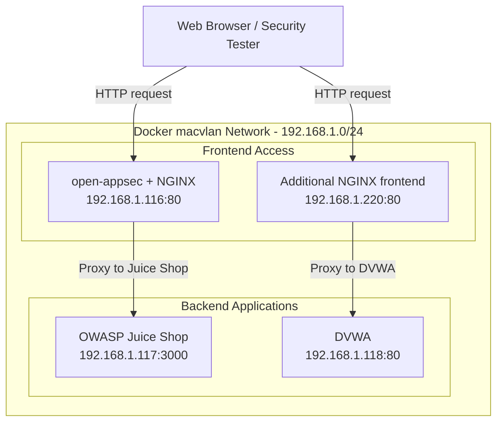

# open-appsec WAF Lab Architecture

## 1. Overview

This lab integrates open-appsec with NGINX to inspect incoming HTTP
traffic before forwarding requests to vulnerable web applications.

The environment contains two frontend access addresses and two backend
applications:

- OWASP Juice Shop
- Damn Vulnerable Web Application (DVWA)

The NGINX configuration uses the local server address to select
the corresponding backend application.

## 2. Network Architecture

## 3. Network Details

| Component | IP address | Port |
|---|---|---|
| open-appsec + NGINX frontend | 192.168.1.116 | 80 |
| Additional NGINX frontend | 192.168.1.220 | 80 |
| OWASP Juice Shop backend | 192.168.1.117 | 3000 |
| DVWA backend | 192.168.1.118 | 80 |

## 4. Docker Network Configuration

- Network name: macvlan-lab
- Network driver: macvlan
- Subnet: 192.168.1.0/24
- Gateway: 192.168.1.99
- Parent interface: ens18

## 5. Traffic Flow

### OWASP Juice Shop

1. A client sends an HTTP request to 192.168.1.116.
2. NGINX receives the request through the open-appsec integration.
3. open-appsec inspects the request according to its active security policy.
4. Permitted requests are forwarded to 192.168.1.117:3000.
5. Malicious requests can be blocked when the applicable policy is configured to prevent them.

### DVWA

1. A client sends an HTTP request to 192.168.1.220.
2. NGINX receives the request.
3. The NGINX configuration selects 192.168.1.118:80 as the backend.
4. The request is forwarded to DVWA.

The open-appsec inspection path for this additional frontend must be verified separately.

## 6. Security Considerations

- Frontend addresses should be used for client access.
- Backend applications should not be directly accessible to untrusted clients.
- Backend access should be restricted using appropriate network controls.
- Detection and prevention depend on the active open-appsec security policy.
- HTTP responses alone do not prove that an attack was detected or blocked.
